<div align="center">

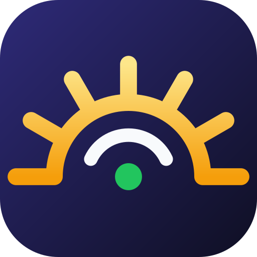

# Tajdîn

**Internet radio, always by your side.**<br />
Kurdish stations and 50,000+ more from around the world, in your browser toolbar.

[](https://chromewebstore.google.com/detail/igldoeednndfkhmigohfblmlppmphock)
[](https://addons.mozilla.org/firefox/addon/tajdin/)
[](https://0xdolan.github.io/tajdin/)
<br />
[](https://github.com/0xdolan/tajdin/actions/workflows/ci.yml)
[](https://github.com/0xdolan/tajdin/releases/latest)
[](LICENSE)

[Install](#install) · [User guide](https://0xdolan.github.io/tajdin/docs/) · [Website](https://0xdolan.github.io/tajdin/) · [Changelog](CHANGELOG.md) · [Privacy](docs/privacy-policy.md)

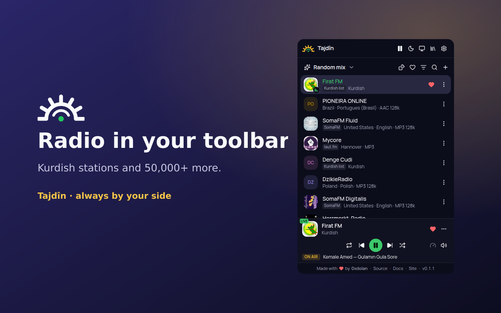

</div>

## Why the name Tajdîn?

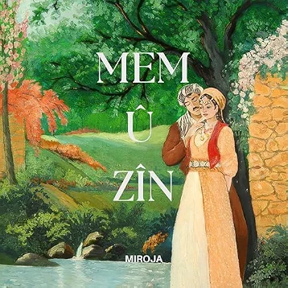

The name comes from **[_Mem û Zîn_](https://en.wikipedia.org/wiki/Mem_and_Zin)**, the great Kurdish
love epic written in 1692 by [Ehmedê Xanî](https://en.wikipedia.org/wiki/Ahmad_Khani). It tells of
Mem and Zîn, two lovers kept apart by the jealous Beko, and it is often called the national epic of
Kurdish literature.

**Tajdîn** (Tacdîn) is Mem's best friend. He stands by Mem to the very end, and when Beko's treachery
comes to light, it is Tajdîn who avenges him. A loyal companion who never leaves your side: that's
what this radio wants to be. Hence the motto, _always by your side_.

📖 Read the epic: [_Mem û Zîn_ (Kurdish edition)](https://www.amazon.com/Mem-%C3%BC-Zin-kurdiya-Dost/dp/9944382515)

Radio keeps people close to home. For Kurdish listeners spread across many countries, it's often
the easiest way to hear their own language, but Kurdish stations are hard to find in big global
directories. Tajdîn puts a **hand-picked Kurdish list** next to the world's open radio directories,
in a player that keeps going while you browse. Its logo is the _Roj_, the sun from Kurdish _deq_
tattoos, a sign of life and light, here broadcasting.

No accounts. No tracking. No servers of our own. Everything you save stays in your browser.

<br clear="right" />

## Features

- 🎲 **A fresh mix every time.** The popup opens on new random stations, or on your favourites, a
  playlist, a group or a language.
- 🌍 **Four directories, one search.** Tajdîn's Kurdish list, [Radio Browser](https://www.radio-browser.info/)
  (50,000+ stations), [SomaFM](https://somafm.com/) and [laut.fm](https://laut.fm/). Search by name
  or tag, filter by language, or use regular expressions.
- ▶️ **A real player.** It keeps playing when the popup closes and has play/pause, previous/next,
  random, repeat (list, or one station with automatic reconnect), volume with mouse-wheel control,
  speed for local files, and an optional "On air" song line.
- 🌞 **A living toolbar icon.** The Roj is grey when idle, amber when paused, and its wave pulses
  green while playing.
- 📚 **Your library.** Favourites (one tap away in the popup, with their own tab in Options),
  ordered playlists that skip offline stations, hand-picked groups, and **language groups** that
  gather every station in a language.
- 🔎 **Filter, search and sort everywhere.** Every list (random mix, search results, favourites,
  playlists, groups, your stations) can be filtered by text, language and source and sorted by
  name, country, language, quality or source.
- 🔗 **Play anything.** Add any stream URL as your own station, or play a link or an audio file
  once.
- 🖥️ **Desktop view and website.** A full-window player that starts as soon as it opens, also at
  [0xdolan.github.io/tajdin](https://0xdolan.github.io/tajdin/).
- ⌨️ **Keyboard-first.** Media keys and browser-wide shortcuts, in-app keys, and keyboard
  reordering of playlists.
- 💾 **Backup you control.** JSON export/import with a preview and merge or replace per section,
  between Chrome, Firefox and the web.
- 🌙 Light, dark and system themes · accessible · right-to-left names · Kurdish Sorani fonts
  included.

<table>
  <tr>
    <td>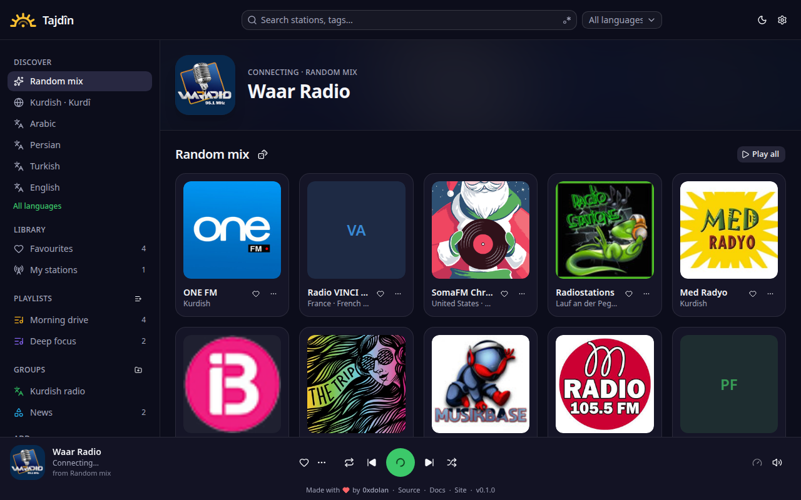</td>
    <td>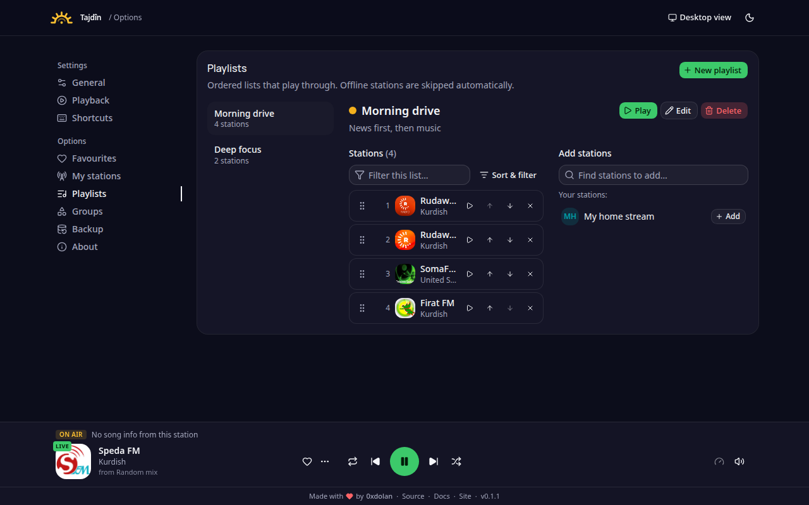</td>
  </tr>
  <tr>
    <td align="center"><sub>Desktop view: grid, now playing, big player</sub></td>
    <td align="center"><sub>Playlists: drag or keyboard to reorder</sub></td>
  </tr>
  <tr>
    <td>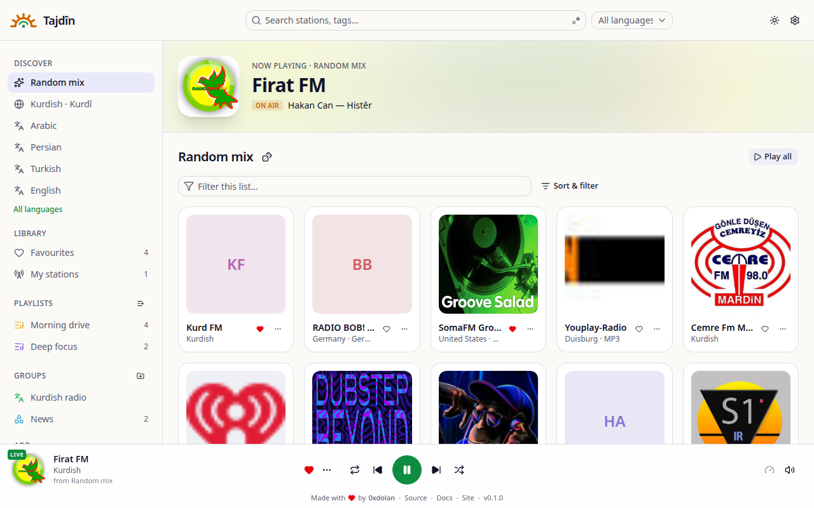</td>
    <td>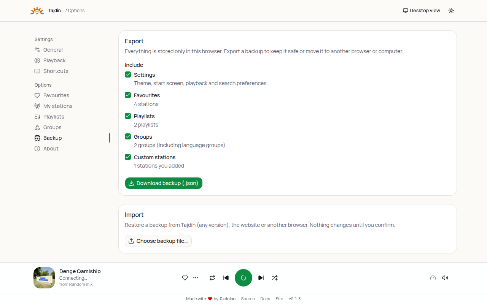</td>
  </tr>
  <tr>
    <td align="center"><sub>Light theme</sub></td>
    <td align="center"><sub>Backup: export and import with preview</sub></td>
  </tr>
  <tr>
    <td>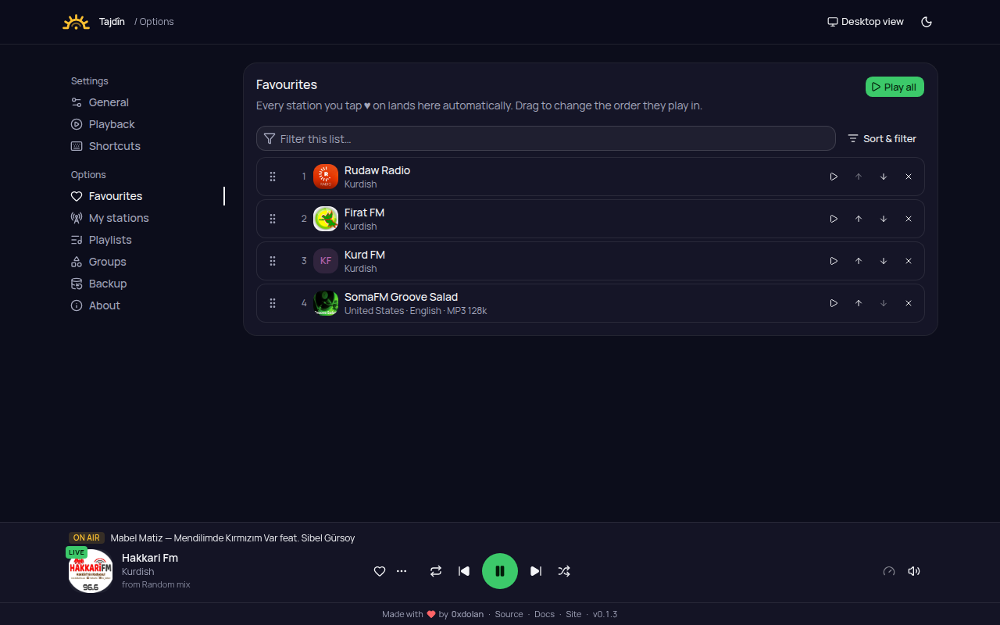</td>
    <td>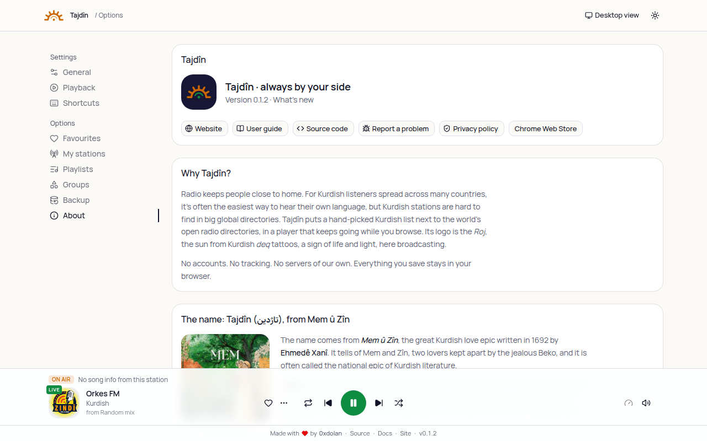</td>
  </tr>
  <tr>
    <td align="center"><sub>Favourites: filter, sort, drag to reorder</sub></td>
    <td align="center"><sub>About: why the name, from <i>Mem û Zîn</i></sub></td>
  </tr>
</table>

<p align="center">
  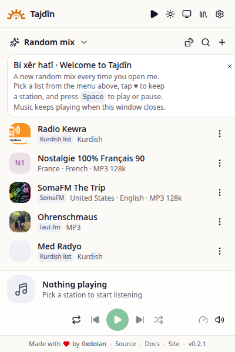
  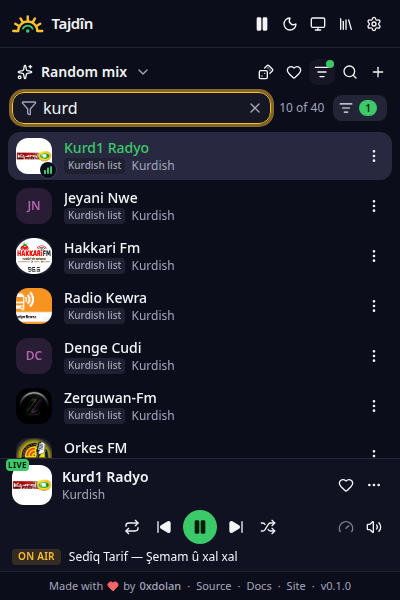
  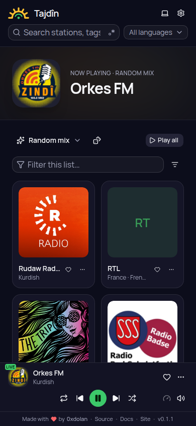
</p>

## Install

| Browser                             | Install                                                                                       |
| ----------------------------------- | --------------------------------------------------------------------------------------------- |
| Chrome, Edge, Brave, Vivaldi, Opera | [Chrome Web Store](https://chromewebstore.google.com/detail/igldoeednndfkhmigohfblmlppmphock) |
| Firefox (desktop and Android)       | [Firefox Add-ons](https://addons.mozilla.org/firefox/addon/tajdin/)                           |
| Any browser, nothing to install     | [0xdolan.github.io/tajdin](https://0xdolan.github.io/tajdin/)                                 |

### Install from a release zip

Every [release](https://github.com/0xdolan/tajdin/releases/latest) has ready-built zips:

- **Chrome / Chromium:** download `tajdin-<version>-chrome.zip` and unzip it. Open
  `chrome://extensions`, turn on **Developer mode**, click **Load unpacked** and pick the unzipped
  folder.
- **Firefox:** download `tajdin-<version>-firefox.zip`. Open `about:debugging#/runtime/this-firefox`,
  click **Load Temporary Add-on…** and pick the zip. A temporary add-on lasts until Firefox
  restarts; for a permanent install use Firefox Add-ons.

Check downloads against `SHA256SUMS.txt` with `sha256sum -c SHA256SUMS.txt`.

### Build it yourself

```bash
git clone https://github.com/0xdolan/tajdin.git && cd tajdin
corepack enable && pnpm install
pnpm build:extension     # → apps/extension/.output/{chrome-mv3,firefox-mv2} and zips
```

Each release also includes `tajdin-<version>-sources.zip`, which contains the exact source for that
version.

## Using Tajdîn

1. Click the **Roj** icon. A random mix appears; click any station to play it.
2. Tap **♥** to keep a station; use **⋮** to add it to a playlist or group, or copy its link.
3. Use the list menu at the top to switch to Kurdish stations, a language, your favourites, a
   playlist or a group.
4. Use **🔍** to search everything, and **+** to play a link or file or add your own station.
5. Open **⚙ Settings** to choose what the popup opens on, turn on song titles, and back up your
   library.

Media keys work anywhere. In the popup: <kbd>Space</kbd> play/pause · <kbd>N</kbd>/<kbd>P</kbd>
next/previous · <kbd>R</kbd> random · <kbd>M</kbd> mute.

📖 Full guide: **[0xdolan.github.io/tajdin/docs](https://0xdolan.github.io/tajdin/docs/)** ([source](docs/user-guide.md))

## Privacy

Tajdîn collects nothing. Your settings and library are stored locally in your browser; station
searches go to the directories and audio comes from each station's own server. Read the
[privacy policy](docs/privacy-policy.md).

## For developers

```text
apps/extension   WXT, Chrome MV3 (offscreen audio) + Firefox MV2 (background audio)
apps/web         Vite, GitHub Pages site + /docs
packages/core    data model, station sources, storage, backup, player (no React)
packages/ui      shadcn/ui components + the shared app (popup, settings, desktop)
```

| Command                | What it does                                      |
| ---------------------- | ------------------------------------------------- |
| `pnpm dev`             | Chrome with hot reload (`dev:firefox`, `dev:web`) |
| `pnpm check`           | Lint, format, types, unit tests                   |
| `pnpm build:extension` | Chrome, Firefox and sources zips                  |
| `pnpm screenshots`     | End-to-end run in Chromium + screenshots          |

Built with TypeScript, React 19, Tailwind CSS 4, [shadcn/ui](https://ui.shadcn.com/),
[WXT](https://wxt.dev/), Vite, Zod, Vitest, Playwright, pnpm and Turborepo.

- [Architecture](docs/architecture.md) · [Development](docs/development.md) ·
  [Releasing and store setup](docs/releasing.md) · [Store listing](docs/store-listing.md)
- [Contributing](CONTRIBUTING.md): gitflow, Conventional Commits, house rules
- [Add a Kurdish station](docs/adding-stations.md): one line of JSON, or
  [open an issue](https://github.com/0xdolan/tajdin/issues/new?template=station.yml)

## Credits

Station data from [Radio Browser](https://www.radio-browser.info/) (community-run),
[SomaFM](https://somafm.com/) (listener-supported, please consider donating) and
[laut.fm](https://laut.fm/). The Kurdish station list is curated by the Tajdîn community.

Made with ❤️ by [0xdolan](https://github.com/0xdolan) · [MIT License](LICENSE)
